<div align="center">

# 🗓 TTPU Timetable

**Расписание Турниского политехнического университета в Ташкенте**

Веб-приложение (PWA) и Telegram-бот в одном процессе.<br>
Открывается мгновенно, живёт без интернета, говорит на двух языках.

[](https://www.python.org/)
[](https://fastapi.tiangolo.com/)
[](https://docs.aiogram.dev/)
[](https://sqlite.org/)
[](#offline)
[](#offline)

[✨ Возможности](#features) · [📸 Скриншоты](#screenshots) · [🚀 Быстрый старт](#quickstart) · [⚙️ Настройки](#config) · [🔌 API](#api) · [📴 Офлайн](#offline) · [🔬 Данные](#source) · [🐳 Docker](#docker) · [💬 Контакты](#contacts)

</div>

---

<a id="screenshots" name="screenshots"></a>

## 📸 Скриншоты

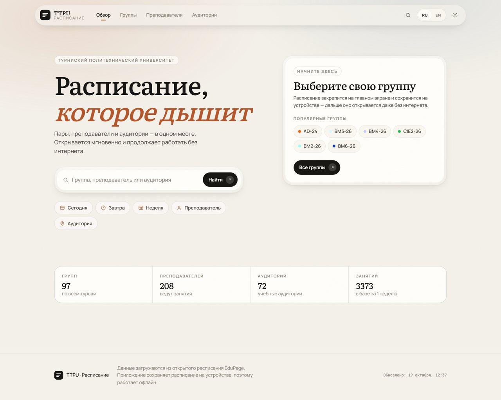

<table>
<tr>
<td width="50%">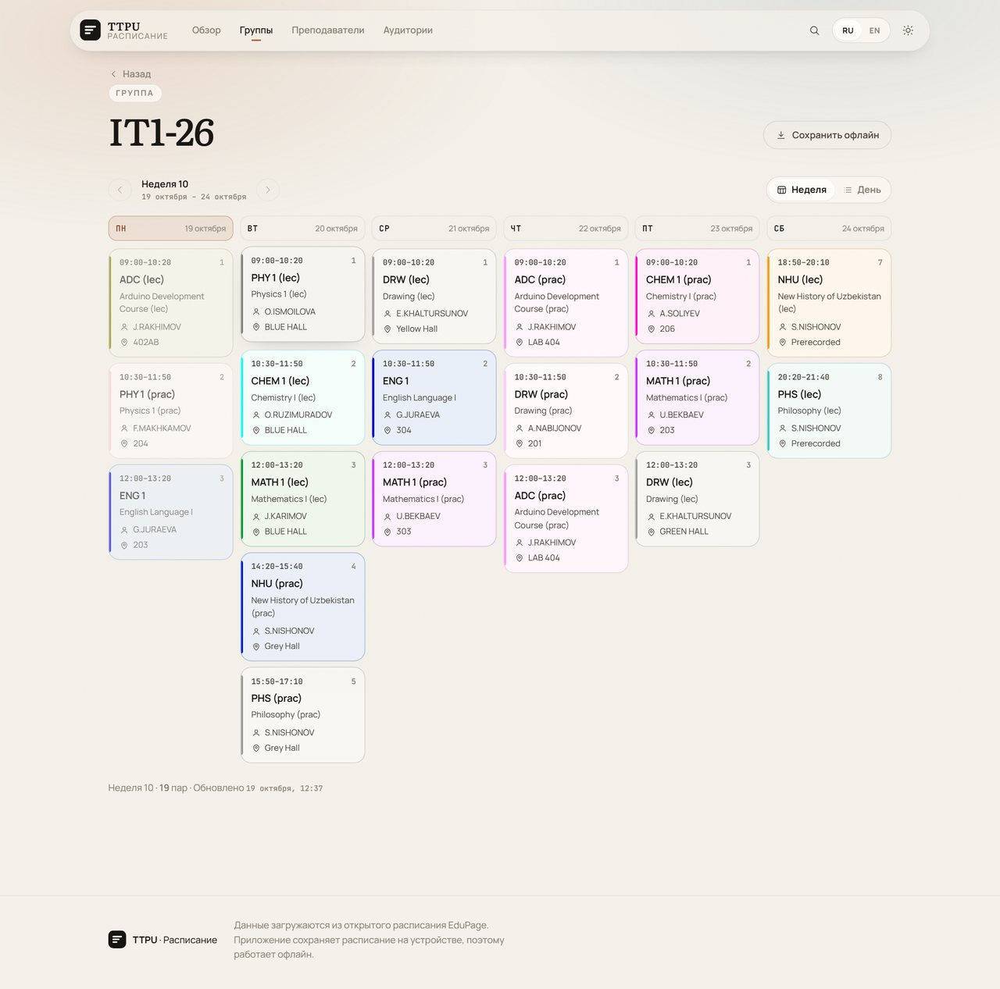</td>
<td width="50%">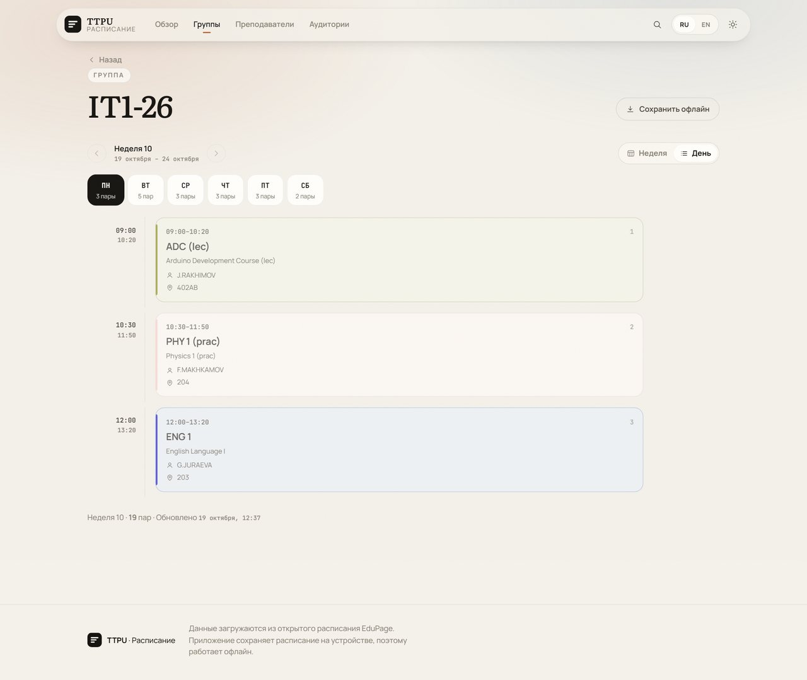</td>
</tr>
<tr>
<td align="center"><sub>Неделя — шесть дней, живые пары и цветовые рельсы по предметам</sub></td>
<td align="center"><sub>День — таймлайн с временем и карточками занятий</sub></td>
</tr>
<tr>
<td>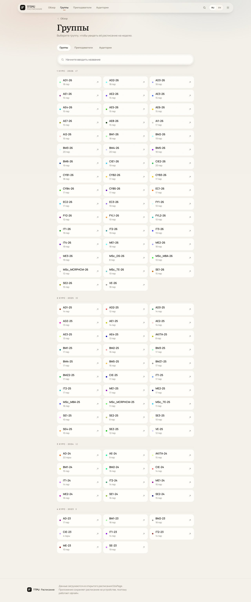</td>
<td>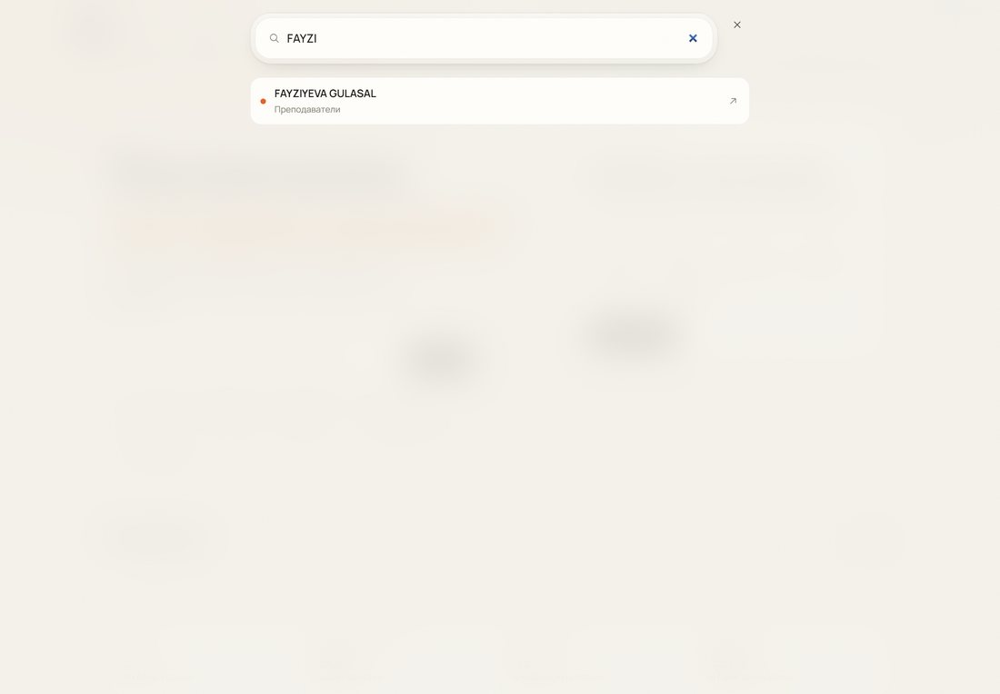</td>
</tr>
<tr>
<td align="center"><sub>Справочник — группы, преподаватели, аудитории с числом пар</sub></td>
<td align="center"><sub>Поиск — по всем разделам сразу, с клавиатуры одним нажатием</sub></td>
</tr>
</table>

### 🌙 Тёмная тема

<table>
<tr>
<td width="50%">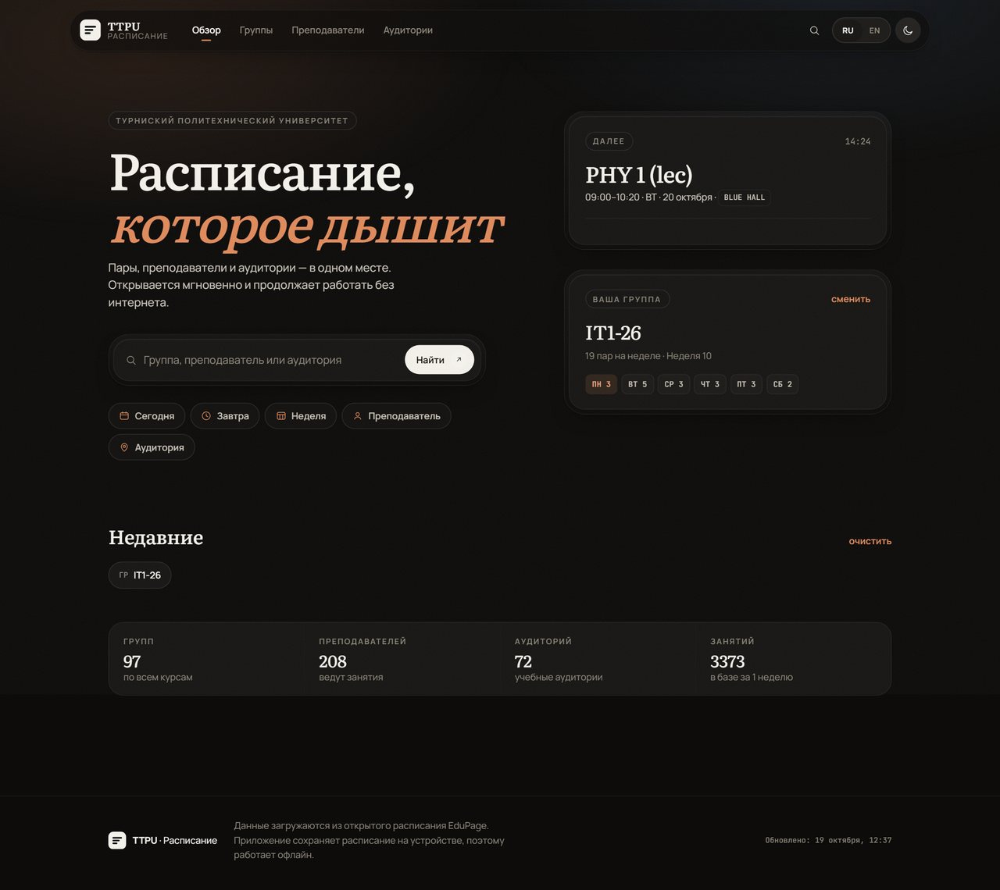</td>
<td width="50%">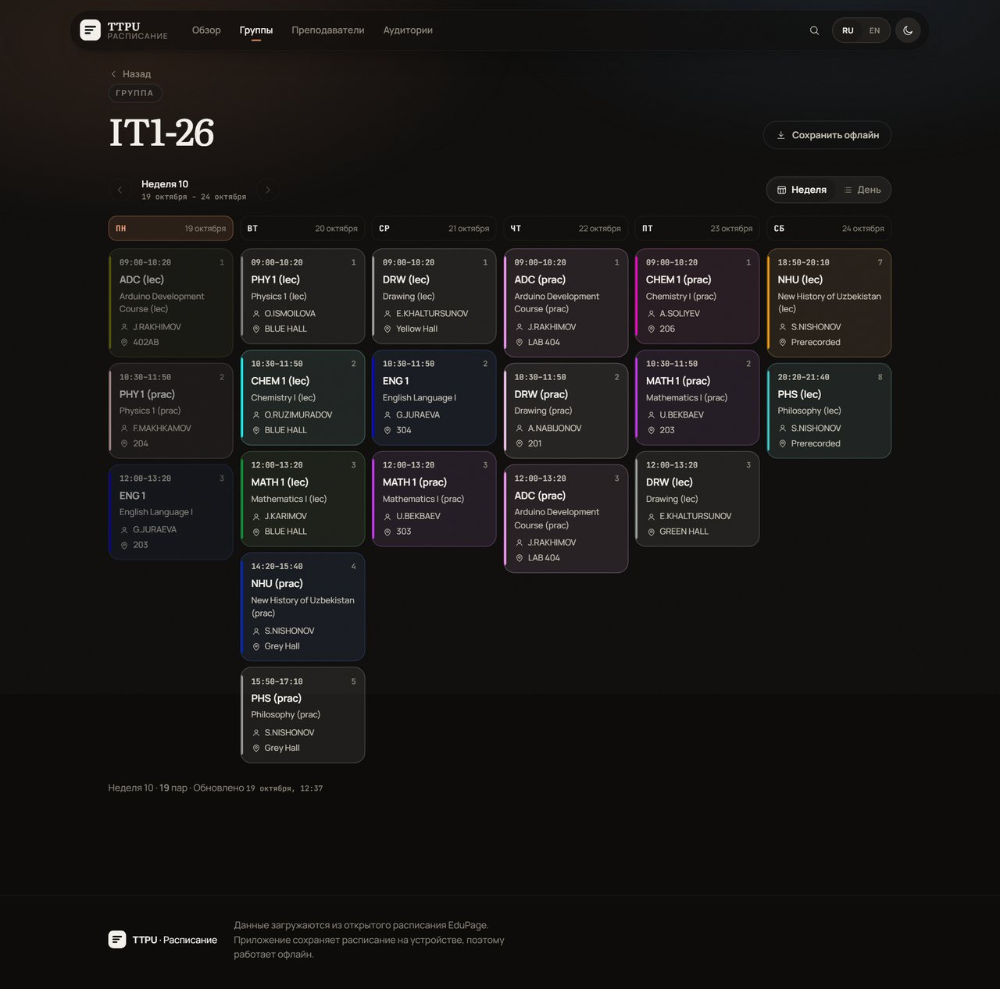</td>
</tr>
</table>

### 📱 Телефон

<table>
<tr>
<td>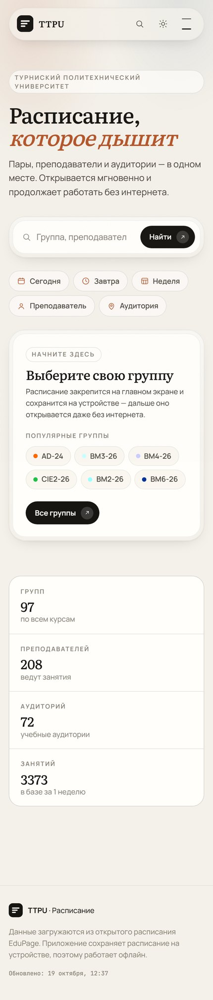</td>
<td>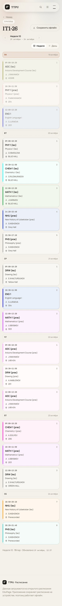</td>
<td>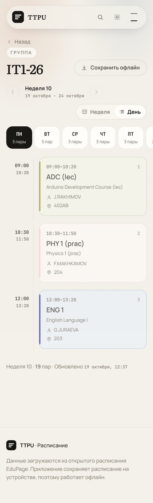</td>
<td>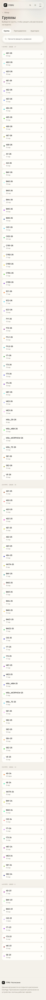</td>
</tr>
<tr>
<td align="center"><sub>Главная</sub></td>
<td align="center"><sub>Неделя</sub></td>
<td align="center"><sub>День</sub></td>
<td align="center"><sub>Группы</sub></td>
</tr>
<tr>
<td>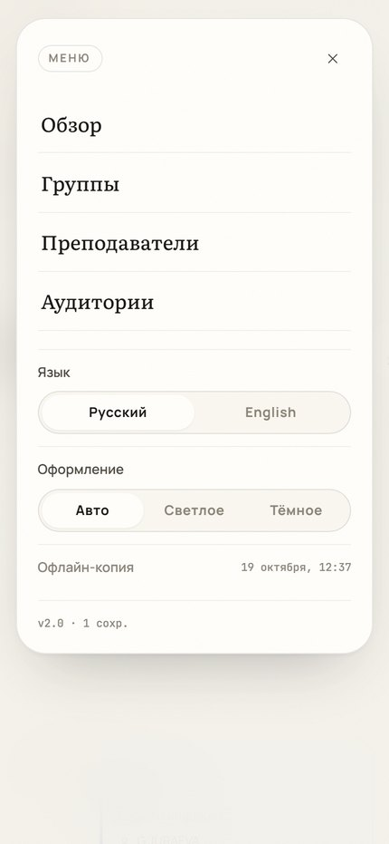</td>
<td>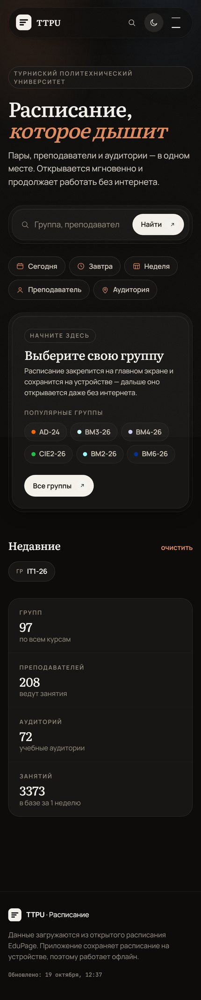</td>
<td>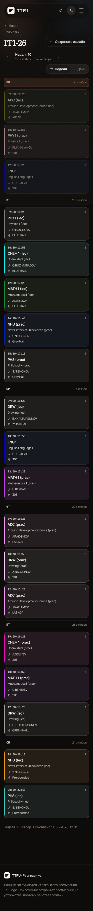</td>
<td>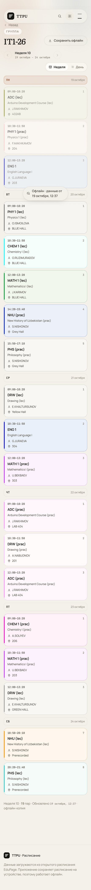</td>
</tr>
<tr>
<td align="center"><sub>Меню</sub></td>
<td align="center"><sub>Тёмная тема</sub></td>
<td align="center"><sub>Неделя (тёмная)</sub></td>
<td align="center"><sub>Без интернета</sub></td>
</tr>
</table>

> Последний кадр снят в режиме полёта: расписание отрисовано из кэша на устройстве.

---

<a id="features" name="features"></a>

## ✨ Возможности

### 🌐 Веб-приложение

| | |
|---|---|
| 🗂 **Три среза** | Расписание по группам, преподавателям и аудиториям — на неделю или на день |
| ⏱ **«Сейчас идёт / Далее»** | Подсветка текущей и следующей пары, полоса прогресса, обратный отсчёт. Считается на клиенте — не требует перерисовки страницы |
| 📴 **Офлайн-режим** | Расписание скачивается на устройство и открывается без сети. [Как это работает](#offline) |
| 🌍 **Русский и английский** | Переключение мгновенное, без перезагрузки |
| 🌗 **Светлая и тёмная темы** | Плюс режим «Авто» по системной настройке |
| 🔍 **Поиск** | По группам, преподавателям и аудиториям; локально и с сервера |
| 📲 **Установка на телефон** | PWA: «Добавить на главный экран» — иконка, свой заголовок, полноэкранный режим |
| 🎨 **Дизайн без шаблонов** | Редакционная типографика, самохостные шрифты, никаких UI-библиотек |

### 🤖 Telegram-бот

| | |
|---|---|
| 👥 **Выбор группы** | С поиском и постраничным списком |
| 📅 **Быстрые срезы** | `Сегодня`, `Завтра`, `Вся неделя`, `Ближайшая пара` |
| 👤 **Преподаватели и аудитории** | Расписание любого преподавателя или аудитории |
| 🌅 **Утренний дайджест** | Пары на день в заданное время |
| ⏰ **Напоминание перед парой** | За N минут до начала |
| ⚙️ **Настройки в чате** | Уведомления включаются инлайн-кнопками, без веб-интерфейса |

---

## 🏗 Как это устроено

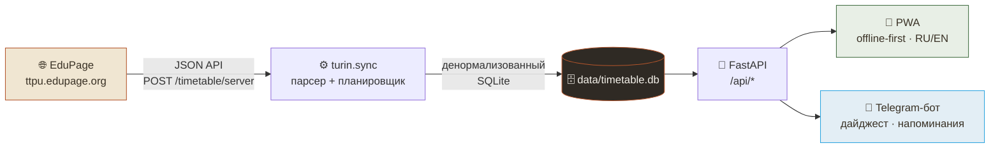

Один процесс делает всё: тянет расписание с EduPage, складывает в SQLite,
отдаёт HTTP-API с веб-приложением и параллельно крутит Telegram-бота.

Ключевое решение — **денормализованное хранилище**: одна строка на
`(неделя, вид владельца ∈ class | teacher | room, владелец, день, пара)`.
Благодаря этому один и тот же урок доступен и группе, и преподавателю, и
аудитории — без `JOIN`-ов на чтении и без риска рассинхронизации.

---

<a id="quickstart" name="quickstart"></a>

## 🚀 Быстрый старт

Нужен **Python 3.11+** (используется `zoneinfo`).

```bash
git clone https://github.com/u2kdev/turintime.git
cd turintime

python -m venv .venv
.venv\Scripts\activate          # Windows
# source .venv/bin/activate     # Linux / macOS

pip install -r requirements.txt
copy .env.example .env          # Windows   (cp .env.example .env на Linux/macOS)
```

Откройте `.env` и впишите токен бота — **необязательно**, без него веб-приложение
работает полностью:

```dotenv
BOT_TOKEN=123456789:AA...       # токен от @BotFather
BOT_USERNAME=your_bot           # без @, нужен только для ссылок в интерфейсе
```

Запуск:

```bash
python main.py           # веб-сервер + бот
python main.py update    # только скачать расписание и выйти
```

<table>
<tr><td>🌐 Приложение</td><td><a href="http://localhost:8000">localhost:8000</a></td></tr>
<tr><td>📖 Документация API</td><td><a href="http://localhost:8000/api/docs">localhost:8000/api/docs</a></td></tr>
<tr><td>💚 Проверка живости</td><td><a href="http://localhost:8000/api/health">localhost:8000/api/health</a></td></tr>
</table>

> Первый запуск скачивает расписание с EduPage (несколько секунд) и складывает его
> в `data/timetable.db`. Дальше обновление идёт фоном каждые `REFRESH_HOURS` часов.

### 🤖 Настройка Telegram-бота

1. Напишите [@BotFather](https://t.me/BotFather) → `/newbot` → задайте имя и username.
2. Скопируйте токен вида `123456789:AA...` в `BOT_TOKEN`.
3. Впишите username **без `@`** в `BOT_USERNAME` — тогда в интерфейсе появится кнопка «Открыть бота».
4. Перезапустите `python main.py`. В логе появится `Telegram-бот → включён`.

> 💡 Бот работает через long polling — домен, HTTPS и вебхук не нужны.
>
> ⚠️ Если запущено несколько экземпляров приложения, бот должен быть включён **только на одном**
> (`RUN_BOT=false` на остальных), иначе Telegram вернёт конфликт polling.

<details>
<summary><b>🛠 Вспомогательные скрипты</b> (нужны только при работе над дизайном)</summary>

<br>

```bash
python scripts/fetch_fonts.py         # скачивает woff2 в web/assets/fonts
python scripts/make_icons.py          # рисует иконки PWA в web/icons
python tests/shoot_web.py             # снимает скриншоты экранов
python scripts/export_screenshots.py  # собирает галерею для этого README
```

Для скриншотов нужен Playwright:

```bash
pip install playwright
playwright install chromium
```

</details>

---

<a id="config" name="config"></a>

## ⚙️ Настройки

Все параметры читаются из `.env`. Полный список с комментариями — в
[`.env.example`](.env.example).

| Переменная | По умолчанию | Назначение |
|---|---|---|
| `BOT_TOKEN` | — | Токен бота от [@BotFather](https://t.me/BotFather). Пусто → бот выключен |
| `BOT_USERNAME` | — | Имя бота без `@`; из него собирается ссылка `https://t.me/<username>` |
| `BASE_URL` | `http://localhost:8000` | Внешний адрес приложения (ссылки, PWA) |
| `HOST` / `PORT` | `0.0.0.0` / `8000` | Где слушает сервер |
| `ADMIN_TOKEN` | — | Токен для `POST /api/refresh`. Пусто → доступ только с localhost |
| `EDUPAGE_ORIGIN` | `https://ttpu.edupage.org` | Источник расписания |
| `SCHOOL_NAME` / `SCHOOL_SHORT` | TTPU | Название в интерфейсе |
| `TIMEZONE` | `Asia/Tashkent` | Часовой пояс для «сейчас» и рассылок |
| `REFRESH_HOURS` | `6` | Как часто перекачивать расписание |
| `REFRESH_ON_START` | `true` | Обновлять при старте сервера |
| `RUN_BOT` | `true` | Выключить бота, оставив веб-приложение |
| `DAILY_DEFAULT_TIME` | `07:30` | Время утреннего дайджеста по умолчанию |
| `REMINDER_MINUTES` | `15` | За сколько минут предупреждать о паре |

---

<a id="api" name="api"></a>

## 🔌 API

Базовый префикс — `/api`, формат — JSON. `{kind}` — одно из `class`, `teacher`,
`room`. `{id}` — идентификатор EduPage, например `*98` (IT1-26); URL-кодируется.

| Метод | Путь | Описание |
|:---:|---|---|
| `GET` | `/api/health` | Жив ли сервис и готова ли база |
| `GET` | `/api/meta` | Сводка: школа, время сервера, статистика, ссылка на бота |
| `GET` | `/api/weeks` | Список учебных недель |
| `GET` | `/api/directory` | Группы, преподаватели, аудитории, предметы, периоды, «популярные» |
| `GET` | `/api/search?q=` | Поиск по справочнику |
| `GET` | `/api/schedule/{kind}/{id}` | Расписание на неделю. `?week=<номер>` или `?day=ГГГГ-ММ-ДД` |
| `GET` | `/api/now/{kind}/{id}` | Текущая и ближайшая пара |
| `GET` | `/api/offline/{kind}/{id}` | Компактный пакет всех недель для офлайн-кэша |
| `POST` | `/api/refresh` | Ручное обновление (нужен заголовок `X-Admin-Token`) |
| `GET` | `/api/refresh/status` | Состояние последнего обновления |

<details>
<summary><b>Пример ответа <code>/api/now/class/*98</code></b></summary>

<br>

```json
{
  "now": "2026-10-19T12:26:43+05:00",
  "today": { "idx": 0, "date": "2026-10-19", "ru": "Понедельник", "count": 1 },
  "current": {
    "key": "*557",
    "period": 3,
    "start": "12:00",
    "end": "13:20",
    "subject": "English for Academic Purposes",
    "short": "EAP",
    "color": "#99FF33",
    "teachers": [{ "name": "FAYZIYEVA GULASAL", "short": "G.FAYZIYEVA" }],
    "rooms": [{ "name": "C405", "short": "C405" }]
  },
  "next": { "short": "DELS (lec)", "start": "12:00", "end": "13:20" },
  "current_left_minutes": 53,
  "progress": 0.334
}
```

</details>

---

<a id="offline" name="offline"></a>

## 📴 Как работает офлайн

Задача: открыв приложение один раз с интернетом, дальше видеть расписание
даже без сети.

<table>
<tr><th>Слой</th><th>Что кэшируется</th><th>Где лежит</th></tr>
<tr>
<td>1️⃣ Оболочка</td>
<td>HTML, CSS, JS, шрифты, иконки</td>
<td><code>Cache Storage</code> (service worker)</td>
</tr>
<tr>
<td>2️⃣ Справочник</td>
<td>Группы, преподаватели, аудитории, метаданные</td>
<td><code>localStorage</code></td>
</tr>
<tr>
<td>3️⃣ Расписание</td>
<td>Все недели выбранной сущности</td>
<td><code>localStorage</code> — ключ <code>ttpu.bundle.v1.class.&lt;id&gt;</code></td>
</tr>
<tr>
<td>4️⃣ Страховка</td>
<td>Ответы <code>/api/offline/*</code></td>
<td><code>Cache Storage</code>, стратегия <em>network-first</em></td>
</tr>
</table>

1. **Оболочка.** Service worker (`web/sw.js`) кладёт статику в `Cache Storage` —
   повторный запуск отдаётся из кэша мгновенно.
2. **Данные.** Справочник и метаданные сохраняются в `localStorage`. Расписание
   группы — целиком, во все доступные недели — кладётся туда после первого
   открытия или по кнопке **«Сохранить офлайн»**.
3. **Без сети.** Интерфейс читает `localStorage`: рисует сохранённое расписание и
   показывает плашку «Офлайн · данные от …». Блоки «Сейчас идёт» и «Далее»
   считаются локально, поэтому тоже работают.
4. **Страховка.** Запросы `/api/offline/*` идут по стратегии *network-first* с
   откатом в `Cache Storage` — на случай, если `localStorage` очистили, а сеть
   пропала.

**Проверка вручную:** откройте приложение, выберите группу, включите режим полёта
и перезагрузите страницу — расписание останется на месте.

---

<a id="source" name="source"></a>

## 🔬 Откуда берутся данные

Парсер работает напрямую с публичным JSON-API EduPage — **без Playwright и
браузера**, в отличие от классических скрейперов.

Все запросы — `POST` на `{EDUPAGE_ORIGIN}/timetable/server/<endpoint>` с заголовком
`Content-Type: application/json; charset=UTF-8` и телом:

```json
{ "__args": [null, 2026], "__gsh": "00000000" }
```

| Endpoint | `__args` | Что возвращает |
|---|---|---|
| `ttviewer.js?__func=getTTViewerData` | `[null, <год начала учебного года>]` | Список учебных недель (`tt_num`, даты, `default_num`) |
| `regulartt.js?__func=regularttGetData` | `[null, "<tt_num>"]` | Таблицы одной недели: уроки, группы, преподаватели, аудитории, предметы, периоды |

<details>
<summary><b>⚠️ Подводные камни, на которые легко наступить</b></summary>

<br>

- Форма `application/x-www-form-urlencoded` возвращает `{"reload": true}` —
  нужен именно JSON.
- `datefrom` учебной недели — **воскресенье**; `dateto = datefrom + 6`.
  Учебные дни — понедельник…суббота, поэтому «понедельник» недели =
  `datefrom + 1 день`.
- Дни кодируются **битовой маской**; в одной ячейке может быть несколько
  подгрупп — например, суббота разбита на `Group 1` / `Group 2` с разными
  аудиториями.
- Список недель меняется: прошедшие недели EduPage убирает. Приложение всегда
  показывает то, что отдаёт источник.

</details>

---

<a id="docker" name="docker"></a>

## 🐳 Docker

```bash
docker compose up --build -d
```

Приложение — <http://localhost:8000>, данные (SQLite) — в томе `ttpu-data`.

<details>
<summary><b>Через <code>docker run</code></b></summary>

<br>

```bash
docker build -t ttpu-timetable .
docker run -d --name ttpu -p 8000:8000 \
  -e BOT_TOKEN=123456789:AA... \
  -e BOT_USERNAME=your_bot \
  -v ttpu-data:/app/data \
  ttpu-timetable
```

</details>

---

## 🧪 Проверки

Скрипты в [`tests/`](tests) не требуют pytest и запускаются как есть.

```bash
python tests/check_parser.py     # разбор одной недели напрямую из EduPage
python tests/test_api.py         # все /api/* через TestClient
python tests/test_bot.py         # тексты, клавиатуры, «ближайшая пара», хранилище
python tests/shoot_web.py        # скриншоты экранов (нужен playwright)
```

---

## 🧰 Технологии

| Слой | Выбор | Почему |
|---|---|---|
| HTTP | **FastAPI** + **uvicorn** | Асинхронность, автодокументация из коробки |
| Источник | **httpx** | Тот же async-стек, без блокирующих вызовов |
| Хранилище | **SQLite** (stdlib) | Ноль зависимостей и настройки, файл рядом с приложением |
| Бот | **aiogram 3** | Long polling, инлайн-клавиатуры, FSM |
| Фронтенд | **Vanilla JS**, без сборки | Открывается мгновенно, нечего собирать и обновлять |
| Стили | **CSS custom properties** | Токены дизайн-системы, темы одним переключателем |
| Шрифты | **Literata**, **Manrope**, **JetBrains Mono** | Самохостные `woff2`, 194 КБ на девять файлов |
| Офлайн | **Service Worker** + `Cache Storage` + `localStorage` | Нативный механизм браузера, без библиотек |

<details>
<summary><b>📁 Структура проекта</b></summary>

<br>

```text
main.py                     точка входа (uvicorn + бот)
turin/
  config.py                 настройки из .env
  edupage.py                клиент и парсер EduPage
  db.py                     схема SQLite, запросы, справочник
  sync.py                   скачивание, запись в базу, планировщик
  schedule.py               «сейчас / далее», сетка дня, офлайн-пакет
  api.py                    FastAPI: /api/*, отдача SPA
  bot/
    runner.py               запуск polling, регистрация команд
    handlers.py             команды и callback-и
    keyboards.py            инлайн-клавиатуры
    texts.py                шаблоны сообщений
    notifier.py             утренний дайджест и напоминания
    storage.py              пользователи и подписки (SQLite)
web/
  index.html                разметка всех экранов
  assets/app.css            дизайн-система
  assets/app.js             маршрутизация, офлайн-кэш, i18n, «сейчас/далее»
  assets/fonts/             самохостные woff2
  sw.js                     service worker
  manifest.webmanifest      PWA-манифест
scripts/                    генераторы шрифтов, иконок и галереи
tests/                      проверки и скриншоты
docs/screenshots/           галерея для этого README
data/                       база расписания и пользователей бота (git-ignored)
```

</details>

---

<a id="contacts" name="contacts"></a>

## 💬 Контакты

Вопросы, идеи и баг-репорты — в Telegram:

[](https://t.me/umwrv)

<div align="center">

---

**Расписание принадлежит Турнискому политехническому университету в Ташкенте.**
Приложение только отображает открытые данные EduPage.

<sub>Сделано с ♥ для студентов TTPU</sub>

</div>
